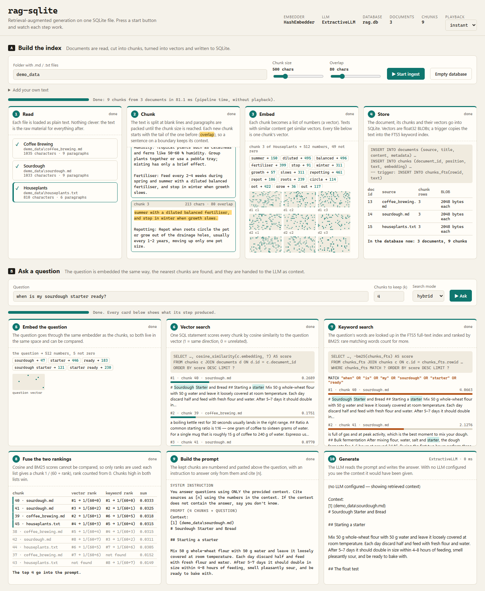

# rag-sqlite

A **minimal, dependency-free RAG (Retrieval-Augmented Generation) system** in a few hundred lines of heavily commented Python,
using **SQLite for both the documents and the vectors**. Built to teach the concept, not to hide it.

```
documents ──► chunk ──► embed ──► SQLite (text + vectors + FTS5)
                                       │
question ──► embed ──► similarity search ─┴──► top-k chunks ──► prompt ──► LLM ──► answer + sources
```

[](#web-interface-watch-every-step)

* **Zero dependencies** – the core and the CLI run offline out of the box (Python 3.10+, stdlib only).
* **Web interface** – `python -m rag serve` opens a local page with start buttons, progress and a live
  picture of every step: reading, chunking, embedding, storing, searching, fusing, prompting, answering.
* **SQLite is the vector store** – embeddings are `float32` BLOBs; cosine similarity is a Python function
  registered into SQLite, so retrieval is one `SELECT ... ORDER BY cosine_similarity(...) LIMIT k`.
* **Hybrid search** – vector search + FTS5 keyword search merged with reciprocal-rank fusion.
* **Generic connectors** – swap embedders/LLMs with an env var: offline hash embedder,
  OpenAI-compatible APIs (OpenAI, Ollama, LM Studio, vLLM…), sentence-transformers, Anthropic Claude.

## Start it without a console

1. Get the folder: **[Download ZIP](../../archive/refs/heads/main.zip)** and unpack it (or `git clone`).
2. Double-click the starter:

| System | File | Notes |
| --- | --- | --- |
| Windows | `start.bat` | If Windows shows "Windows protected your PC": More info → Run anyway. |
| Linux | `start.desktop` or `start.sh` | Right-click → "Allow launching" / "Run as a program" (the wording depends on the desktop). |

The first start installs FastAPI and uvicorn into a `.venv` folder next to the starter (needs internet).
After that it starts at once and opens <http://127.0.0.1:8765/> in your browser. Close the window to stop it.

The only thing that must already be on the computer is [Python 3.10 or newer](https://www.python.org/downloads/)
(on Windows tick "Add python.exe to PATH" in the installer; on Debian/Ubuntu also `python3-venv`).

## Quick start (no API key needed)

```bash
git clone <this repo> && cd rag-sqlite
python -m rag ingest demo_data                    # chunk + embed + store into rag.db
python -m rag search "what water temperature for coffee"
python -m rag ask "when is my sourdough starter ready?"
python -m rag stats
python -m rag serve                               # the same, in the browser (needs fastapi + uvicorn)
```

With the default connectors, `ask` prints the retrieved context instead of a generated answer —
that is exactly the prompt a real LLM would receive. Plug in a real model to get an answer:

```bash
# Claude
pip install anthropic
export ANTHROPIC_API_KEY=sk-ant-...
RAG_LLM=anthropic python -m rag ask "when is my sourdough starter ready?"

# Fully local with Ollama (real semantic embeddings + local LLM)
ollama pull nomic-embed-text && ollama pull llama3.2
RAG_EMBEDDER=ollama python -m rag ingest demo_data      # re-ingest: embedder changed => vectors change
RAG_EMBEDDER=ollama RAG_LLM=ollama python -m rag ask "which plants tolerate low light?"

# OpenAI
export OPENAI_API_KEY=sk-...
RAG_EMBEDDER=openai python -m rag ingest demo_data
RAG_EMBEDDER=openai RAG_LLM=openai python -m rag ask "..."
```

## Web interface: watch every step

```bash
pip install fastapi uvicorn        # only the web interface needs these
python -m rag serve                # starts uvicorn itself and opens http://127.0.0.1:8765
```

Options: `--port 9000`, `--host 0.0.0.0`, `--no-open`, and `--db other.db` before `serve`.
The connectors come from the same env vars as the CLI (`RAG_EMBEDDER`, `RAG_LLM`, see below).

**A · Build the index** – pick a folder (or paste your own text), set chunk size and overlap, press **Start ingest**.

| Step | What you see |
|------|--------------|
| 1 Read   | each file ticked off with its characters and paragraphs |
| 2 Chunk  | the chunks of the selected document, the overlap carried over from the previous chunk highlighted; moving the sliders re-chunks it live, before anything is stored |
| 3 Embed  | one tile per chunk vector (a cell per dimension); with the hash embedder also every token and the bucket it lands in |
| 4 Store  | the SQL that runs and the rows written: document id, chunk rows, BLOB size, running totals |

**B · Ask a question** – type a question, choose `k` and the search mode, press **Ask**.

| Step | What you see |
|------|--------------|
| 5 Embed the question | its tokens and vector |
| 6 Vector search  | the SQL, the ranked chunks with their cosine score, the question's words highlighted |
| 7 Keyword search | the FTS5 `MATCH` query and the chunks ranked by BM25 |
| 8 Fuse           | the reciprocal-rank-fusion table: each chunk's rank in both lists, `1/(60+rank)` summed, the top `k` marked |
| 9 Build the prompt | the system instruction and the exact prompt |
| 10 Generate      | the answer (or, with no LLM configured, the context a model would get) |

The pipeline takes milliseconds, so the **Playback** switch (instant / normal / slow) only slows the display;
the times shown are the real ones. `http://127.0.0.1:8765/?autorun` runs both halves once on load.

How it is built: `rag/steps.py` runs the same functions as the CLI but yields a small dict after every step;
`rag/server.py` (FastAPI) streams those as newline-delimited JSON; `rag/webui/` is three static files of plain
JavaScript, HTML and CSS — no build step, no framework. The API is browsable at `/api/docs`.

## Configuration

| Env var           | Values                                   | Default |
|-------------------|------------------------------------------|---------|
| `RAG_EMBEDDER`    | `hash`, `openai`, `ollama`, `st`         | `hash`  |
| `RAG_LLM`         | `none`, `anthropic`, `openai`, `ollama`  | `none`  |
| `RAG_EMBED_MODEL` | model name override                      | per connector |
| `RAG_LLM_MODEL`   | model name override                      | per connector |
| `OPENAI_BASE_URL` | any OpenAI-compatible endpoint           | `https://api.openai.com/v1` |

> Always **re-ingest after changing the embedder** – vectors from different models are not comparable.

## Use as a library

```python
from rag import RAG, Database
from rag.connectors import HashEmbedder, ExtractiveLLM

rag = RAG(Database("rag.db"), HashEmbedder(), ExtractiveLLM())
rag.add_directory("demo_data")
answer, hits = rag.ask("How much coffee per cup?", k=3, mode="hybrid")
```

See [`example.py`](example.py).

## Write your own connector

Connectors are plain classes matching two tiny `Protocol`s (`rag/connectors/base.py`) – no inheritance needed:

```python
class MyEmbedder:
    def embed(self, texts: list[str]) -> list[list[float]]: ...

class MyLLM:
    def generate(self, system: str, prompt: str) -> str: ...

rag = RAG(Database("rag.db"), MyEmbedder(), MyLLM())
```

## Project layout

```
rag/
├── chunking.py            split text into overlapping chunks
├── db.py                  SQLite schema, vector BLOBs, cosine_similarity(), FTS5 keyword search
├── pipeline.py            RAG class: add_document / retrieve / ask, reciprocal-rank fusion
├── __main__.py            CLI (ingest / search / ask / stats / serve)
├── steps.py               the pipelines one step at a time, each step described (feeds the web interface)
├── server.py              FastAPI app + uvicorn launcher for the web interface
├── webui/                 index.html, app.js, style.css – plain JavaScript, no build step
└── connectors/
    ├── base.py            Embedder + LLM protocols
    ├── local.py           HashEmbedder (offline), ExtractiveLLM (prints context)
    ├── openai_compat.py   OpenAI / Ollama / LM Studio / vLLM via stdlib HTTP
    ├── sentence_transformers.py
    └── anthropic_llm.py   Claude via the official SDK
demo_data/                 three small documents to play with
tests/                     `python -m unittest discover -s tests`
```

## How it works (the concepts)

1. **Chunking** (`chunking.py`) – long documents are split into ~500-character pieces with 80 characters of
   overlap. Small chunks embed more precisely; overlap keeps boundary sentences meaningful.
2. **Embedding** (`connectors/`) – each chunk becomes a vector. Similar meaning ⇒ nearby vectors.
   The built-in `HashEmbedder` is a bag-of-words trick that only captures word overlap; real models
   (Ollama `nomic-embed-text`, OpenAI, sentence-transformers) capture semantics.
3. **Storage** (`db.py`) – `documents`, `chunks` (with the vector BLOB) and an FTS5 index, all in one file.
4. **Retrieval** – cosine similarity in SQL (`vector`), BM25 via FTS5 (`keyword`), or both fused (`hybrid`).
   The scan is linear; for millions of vectors add an index such as `sqlite-vec` – the interface does not change.
5. **Generation** (`pipeline.py`) – top-k chunks are numbered and pasted into a prompt with a system
   instruction to answer *only* from context and cite `[n]`. The LLM's job becomes reading, not remembering.

## Ideas to extend

Re-ranking with a cross-encoder · metadata filters in the SQL `WHERE` · token-based chunking ·
`sqlite-vec` for ANN search · streaming answers · evaluation set with retrieval hit-rate.

## License

MIT
